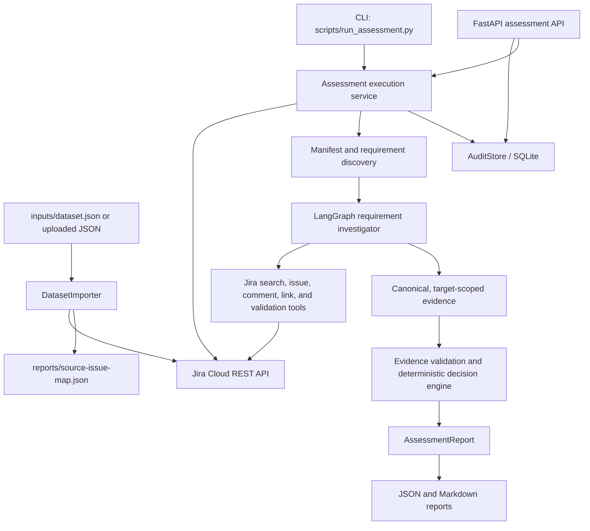

# Architecture

## Overview

The Jira Release Evidence Agent assesses release requirements using records
imported into Jira. Jira is the source of truth during an assessment: the agent
does not pass the complete source dataset to the language model. It discovers
the release manifest and linked requirements, retrieves relevant issues and
comments through Jira tools, validates evidence against the requested target,
and produces an auditable decision report.

## Components

- **Configuration — `app/config.py`:** Loads settings from environment
  variables and the local `.env` file. It defines Jira, LLM provider, resource
  limits, database, report, and dataset paths. Secrets use Pydantic
  `SecretStr`.
- **Dataset and schemas — `app/models/`:** Pydantic models validate imported
  dataset records, assessment API requests, targets, and report structures.
- **Jira integration — `app/jira/`:** `JiraClient` wraps Jira Cloud REST calls;
  `IssueService` scopes discovery to a project and dataset label; and
  `DatasetImporter` creates or updates issues, comments, statuses, and links.
  Stable source IDs and markers support repeatable imports.
- **HTTP API — `app/api/routes.py`:** Provides dataset import, asynchronous
  assessment start/status, and JSON or Markdown report endpoints. `app/main.py`
  wires the router, settings, audit store, logging, and health check.
- **Execution — `app/services/execution_service.py`:** Discovers and validates
  the Jira release manifest and its requirements, investigates each
  requirement, resolves the final decision, aggregates metrics, and saves the
  report.
- **Agent — `app/agent/`:** A LangGraph workflow uses provider-backed chat
  models (Gemini or Groq-compatible) to select investigation tools and return
  structured requirement analyses. Tool calls, recursion, context, and retries
  are bounded by configuration.
- **Assessment logic — `app/assessment/`:** Evidence validation checks target
  applicability and verifier authority. The decision engine applies
  deterministic rules for valid passes and failures, retests, conflicting
  evidence, and insufficient evidence. The model analysis is not accepted as
  proof without validation against the retrieved Jira evidence.
- **Audit and output — `app/services/audit_service.py` and
  `app/assessment/report_generator.py`:** SQLite stores assessment state,
  reports, and investigation events; report generation produces readable
  Markdown alongside structured JSON.

## Assessment flow

1. The CLI or API receives a target release and optional target override.
2. The execution service searches the configured Jira project and dataset
   label. It requires one manifest, exactly 12 linked requirement records, and
   a consistent target across the manifest and requirements.
3. Each requirement is investigated separately. The agent retrieves comments
   and relevant linked records, with configured call, context, and recursion
   limits.
4. Retrieved evidence is validated for the target dimensions (release, commit,
   service, environment, and prompt where applicable), applicability, and
   verifier authority. Exact Jira issue and comment references are retained.
5. Deterministic assessment logic assigns `PASS`, `FAIL`, or
   `INSUFFICIENT_EVIDENCE`; deterministic aggregation produces the overall
   release decision.
6. The report, usage metrics, and investigation trace are persisted and made
   available as JSON and Markdown.

Jira issue status and implementation claims alone do not prove that a
requirement is satisfied. Missing, out-of-scope, inconclusive, or unresolved
conflicting evidence is reported as `INSUFFICIENT_EVIDENCE`.

## Data and report layout

- `inputs/dataset.json` is the import source.
- `reports/source-issue-map.json` records source IDs mapped to Jira issue keys.
- `reports/assessment.sqlite3` stores assessment and investigation state.
- Each completed run writes its JSON/Markdown pair to `reports/final/` under
  the configured `reports_dir`. Existing report files in `final/` are moved to
  `reports/development/` before the new pair is published, retaining earlier
  runs.
- The Markdown report endpoint searches `final/`, `development/`, and the
  legacy report-directory root so previously generated reports remain
  retrievable.

## Main implementation and tests

- Application entry point: `app/main.py`
- Assessment API: `app/api/routes.py`
- Dataset import: `app/jira/importer.py`
- Jira-backed execution: `app/services/execution_service.py`
- Agent workflow and tools: `app/agent/graph.py`, `app/agent/tools.py`
- Evidence rules: `app/assessment/evidence_validator.py`,
  `app/assessment/decision_engine.py`
- Automated tests: `tests/`
